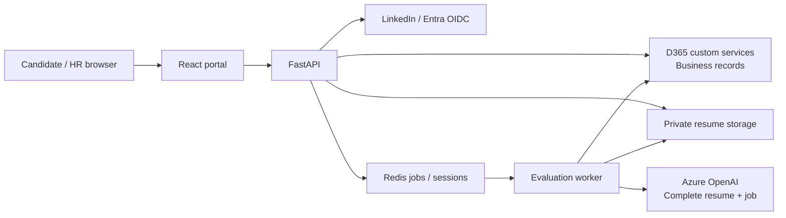
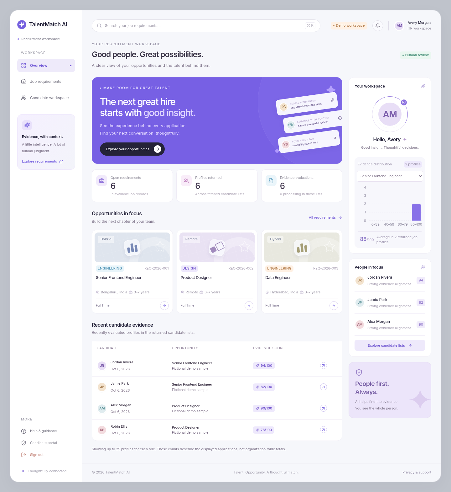

# TalentMatch AI

A recruitment portal with a candidate job board, private resume uploads, and an HR workspace for reviewing AI-generated evidence against each job description. The responsive violet dashboard follows the supplied UI reference.

React communicates with FastAPI. D365 Finance & Operations remains the business system of record; Azure Blob Storage keeps documents private; a Redis-backed worker runs Azure OpenAI evaluations. Scores describe documented job/resume alignment. They do not automate hiring or rejection, and human review is required.

**The default development workflow is explicitly labeled demo mode.** It runs without external credentials, uses fictional jobs/candidates, and lets you upload a real PDF/DOCX and explore a labeled sample evaluation. Connected adapters are implemented separately; live LinkedIn, Entra, D365, Azure OpenAI, and Blob validation requires your configuration and deployed D365 contracts.

## What you can do

- Browse and filter open jobs; read the full job description.
- Sign in as a demo candidate or use configured LinkedIn OIDC in connected mode.
- Upload a validated PDF/DOCX, accept consent, and submit an application with retry protection.
- Review your own application status where the D365 read capability is configured.
- Sign in to the separate HR workspace; inspect candidates for one job and review scores, explanations, and supporting resume evidence.
- Access original resumes through an authorized backend operation.

## Stack and architecture

| Layer | Technologies |
| --- | --- |
| Frontend | React, TypeScript, Vite, Tailwind CSS, Radix UI primitives, Lucide, React Router, TanStack Query, React Hook Form, Zod, Recharts |
| Backend | Python 3.11+, FastAPI, Pydantic v2, HTTPX, MSAL, Authlib, Uvicorn |
| Evaluation | Azure OpenAI SDK, structured JSON validation, versioned evidence prompt |
| Documents | PyMuPDF, python-docx, private Azure Blob Storage; local development adapter |
| Jobs and sessions | Redis-backed background processing and temporary/session state |
| Quality | Pytest, Vitest, Testing Library, ESLint, TypeScript checks, CI |



See [architecture and data ownership](docs/architecture.md) for the processing flow and [API contract](docs/api-contract.md) for frontend/backend interfaces.

## Run locally

Prerequisites: Git, Python 3.11+, [uv](https://docs.astral.sh/uv/getting-started/installation/), and Node.js 22.12+ with npm. Docker is optional for the demo and required for the Compose workflow below. Connected evaluation requires Redis and a separate worker.

```bash
git clone https://github.com/SriTharoon05/UB_HRProcess_Agent.git
cd UB_HRProcess_Agent
```

Install the locked dependencies:

```bash
./scripts/install.sh
```

The installer uses ignored local caches, so it also works in cloud environments with a read-only home directory. It installs development tests and the optional browser-test package; Chromium itself is installed separately when needed.



Create local configuration only when it does not already exist:

```bash
if [ ! -f backend/.env ]; then cp backend/.env.example backend/.env; fi
if [ ! -f frontend/.env ]; then cp frontend/.env.example frontend/.env; fi
```

Keep `DEMO_MODE=true` and `APP_ENV=development` for the first run. The frontend uses same-origin API paths through Vite's development proxy; integration secrets belong only in the backend environment.

```bash
./scripts/dev.sh
```

Open **http://localhost:5173**. Use the labeled candidate/HR demo sign-in options, choose a job, and upload a text-based PDF or DOCX. Sample evaluation values are fixtures, not an Azure OpenAI result. API documentation is available at **http://localhost:8000/docs** in development.

To run the processes in separate terminals:

```bash
cd backend
uv run --frozen uvicorn app.main:app --host 127.0.0.1 --port 8000 --reload
```

```bash
cd frontend
npm run dev -- --host 127.0.0.1 --port 5173
```

`uv` creates `backend/.venv`. For manual activation, use `source backend/.venv/bin/activate` on Linux/macOS or `backend\.venv\Scripts\Activate.ps1` in PowerShell; activation is unnecessary when using `uv run`.

### Docker demo

From the repository root:

```bash
docker compose up --build
```

Open **http://localhost:5173**. Compose runs the frontend, API, and persistent Redis service. Its default is development/demo configuration. Stop it with `docker compose down`; omit `--volumes` to retain local queue/document volumes. This Compose setup is a development starting point, not a production deployment specification.

### Connected evaluation worker

Configure the backend environment, set `DEMO_MODE=false`, and provide Redis. Start the worker in a separate terminal:

```bash
cd backend
uv run --frozen python -m app.worker
```

The API and worker must use the same backend environment, Redis instance/prefix, and private storage configuration. Run Redis with persistence enabled; see [deployment](docs/deployment.md) for service isolation and recovery requirements. Demo evaluation does not require external model credentials or a connected worker.

The repository also provides a [connected production Compose override](compose.production.yml) for use behind an HTTPS ingress; it requires live credentials/contracts and has not been validated against external services. Follow [deployment instructions](docs/deployment.md) before using it.

## Environment and external integrations

The complete variable reference is in [environment configuration](docs/environment.md); copy the committed examples and supply secrets through your environment settings or a secret manager. Do not commit real `.env` files or put credentials in `VITE_` variables.

| Integration | What is implemented | What you must configure/verify |
| --- | --- | --- |
| D365 requirements | Backend token client, configurable request mapping and typed normalization | Existing `getOpenRequirements` actual X++ signature/response and application permissions |
| D365 submission | Candidate identity, private document metadata, stable-ID validation | Existing `submitApplication` fields, returned `ApplicationId`, server-side idempotency |
| D365 evaluations | Structured evaluation mapping and save adapter | Deploy `saveCandidateEvaluation`, then set the currently empty path |
| D365 rankings | Job-specific candidate/evidence normalization | Deploy `getTopCandidates`, then set the currently empty path |
| Candidate history/detail | Optional configurable D365 read adapters with ownership checks | Additional confirmed read operations; the four main operations alone do not provide this capability |
| LinkedIn | Backend OIDC authorization-code flow and session creation | Client credentials, enabled OIDC product, exact registered redirect URI |
| HR authentication | Separate Entra OIDC flow and HR role authorization | Tenant/app registration, redirect URI, assigned application role |
| Azure OpenAI | Complete-document evidence prompt, structured output validation, evidence checks | Endpoint/key/deployment/API-version compatibility and live model smoke test |
| Resume storage | Validated local development uploads and private Blob adapter | Private container, access controls, connection settings, retention/deletion policy |
| Background jobs | Redis-backed processing, retries, idempotency coordination | Persistent private Redis, worker deployment and monitoring; D365 write contracts |

No live external integration is claimed verified without its configured credentials/contracts. Missing connected integrations return useful errors instead of demo records.

## D365 deployment handoff

The supplied existing operations are `getOpenRequirements` and `submitApplication` under `UBHRApplicationServiceGroup/UBHRApplicationService`. Their contracts remain assumptions until actual responses are checked. This repository does not create or deploy D365 tables or X++ methods.

The new endpoint example values deliberately remain empty:

```dotenv
D365_SAVE_EVALUATION_PATH=
D365_TOP_CANDIDATES_PATH=
```

Use [proposed table definitions](docs/d365-schema.md) and [endpoint examples](docs/d365-endpoints.md) to implement and validate them. Completed evaluations need an idempotent upsert keyed by the application. Independent D365 Processing/Failed updates, HR status changes, and deletion require additional confirmed write contracts; the portal does not pretend those writes exist. The rankings contract supports a top-N limit, not a verified total population count or server-side pagination.

## Test and build

```bash
./scripts/check.sh
```

Or run the checks separately:

```bash
(cd backend && uv run --frozen --extra dev python -m pytest)
(cd backend && uv run --frozen --extra dev ruff check app tests ../scripts/smoke.py)
(cd frontend && npm run lint)
(cd frontend && npm run typecheck)
(cd frontend && npm run test)
(cd frontend && npm run build)
```

Automated tests mock external services and do not need real credentials. Production builds are written to `frontend/dist`. CI runs the locked installation, repository checks, and demo browser workflow. A successful local build/test validates the application code and mocked contracts; external registration, deployed X++, networking, and Azure permissions still require live acceptance checks.

See [validation results](docs/validation.md) for the executed checks and remaining live integration requirements.

### Browser smoke test

With `./scripts/dev.sh` running in demo mode, use another terminal:

```bash
cd backend
uv run --frozen --extra e2e playwright install chromium
uv run --frozen --extra e2e python ../scripts/smoke.py
```

If Chromium is already installed, the script discovers `chromium` or accepts `CHROMIUM_PATH=/path/to/chromium`; then the browser-install step is unnecessary. `SMOKE_BASE_URL` can select a different running demo origin. The test generates a synthetic PDF, submits a fictional application, checks candidate history and HR access/evidence, downloads the private resume, and checks mobile navigation and browser errors. It creates only demo/local test data and never calls live D365 or Azure services.

## Security and production

Sessions use backend cookies; role and candidate ownership checks run in FastAPI. State-changing browser requests require CSRF protection. Documents stay private and HR downloads are authorized. The API validates upload size and actual PDF/DOCX content; scanned/empty documents need OCR and are not given fabricated text. Scores, labels, and explanations are decision support and can be wrong; missing evidence does not prove missing ability.

Deploy behind HTTPS with explicit allowed origins, production cookies, demo disabled, private Redis/Blob networking, secrets supplied by a manager such as Azure Key Vault, a separately supervised worker, and coordinated retention controls. See [production deployment](docs/deployment.md), [LinkedIn and HR authentication](docs/linkedin-auth.md), and [Azure OpenAI evaluation](docs/azure-openai.md).

## Repository map

```text
backend/       FastAPI, configuration, auth, integrations, worker, tests
frontend/      React portal, reusable UI, typed API client, tests
docs/          Architecture, API/D365 contracts, integration and deployment guides
scripts/       Locked installation, startup, verification, and browser smoke test
compose.yml    Development containers and Redis persistence
compose.production.yml   Connected services behind your HTTPS ingress
.github/       Automated checks
```

For changes in an existing Codex cloud task, use the provided isolated checkout. A separate Git worktree is unnecessary unless explicitly requested.
