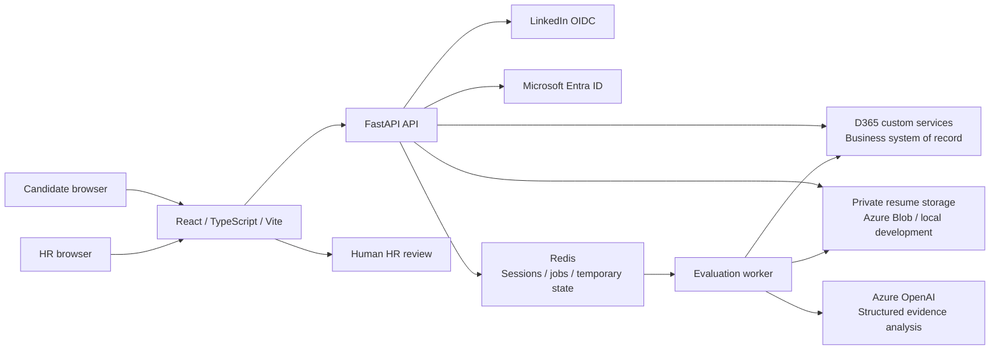

# Architecture and data ownership

TalentMatch AI provides a candidate recruitment portal and an authenticated HR evidence-review workspace. Its violet, rounded dashboard design follows the supplied reference theme. The frontend calls FastAPI; external credentials and integration requests stay on the backend.

## Submission and evaluation

1. FastAPI validates the backend candidate session, CSRF token, explicit consent, open job, resume type/content, and upload size.
2. The storage adapter saves the real document privately and computes its SHA-256. The D365 adapter submits identity from the validated OIDC session and document metadata.
3. A confirmed stable D365 `ApplicationId` identifies the queued evaluation. The response confirms submission without waiting for the model.
4. The worker extracts the complete readable PDF/DOCX text and supplies the complete job context to the Azure OpenAI adapter. The versioned system prompt treats document contents as untrusted data.
5. Pydantic validates structured model output and resume evidence excerpts. Python does not apply a scoring formula or replace the model score.
6. The evaluation adapter serializes evidence arrays for X++ memo fields and saves the result through D365. Retried writes require D365-side upsert/idempotency semantics.
7. HR reads job-specific candidates and detailed evidence through FastAPI. Scores organize the displayed results; a human reviews evidence and makes employment decisions.

## Storage boundaries

| Component | Data responsibility |
| --- | --- |
| D365 F&O | Job requirements, candidate identities, applications, persisted evaluations, existing HR status |
| Azure Blob Storage | Private original PDF/DOCX documents |
| Redis | Protected session data, idempotency coordination, temporary processing context, queue/retry state |
| Backend local storage | Development-only private document adapter |
| React | Presentation and transient form/query state; no integration secrets |

There is no PostgreSQL/MySQL mirror. Redis persistence helps queue recovery but does not replace D365 business-record persistence. Document retention, D365 record retention, Redis expiry, and backup retention must be coordinated.

## Demo boundary

`DEMO_MODE=true` selects separate fictional data and evaluation adapters. Demo authentication is allowed only in development. The application form still validates and stores a real uploaded document; its sample score is visibly a demo fixture. Connected mode returns integration errors when required configuration/services are absent and does not switch to fictional records.

## Contract boundaries

The first two D365 operations are reported as existing by the project requirements, but their actual request/response bodies have not been supplied. Centralized mappings isolate those assumptions. Saving evaluations and retrieving ranked candidates require newly deployed X++ operations. Candidate-owned history/details need additional confirmed ownership-scoped reads. HR details/documents can use the trusted selected-job `getTopCandidates` response within its top-100 limit, or a separately configured single-application read. See [D365 endpoints](d365-endpoints.md) and [API contract](api-contract.md).
