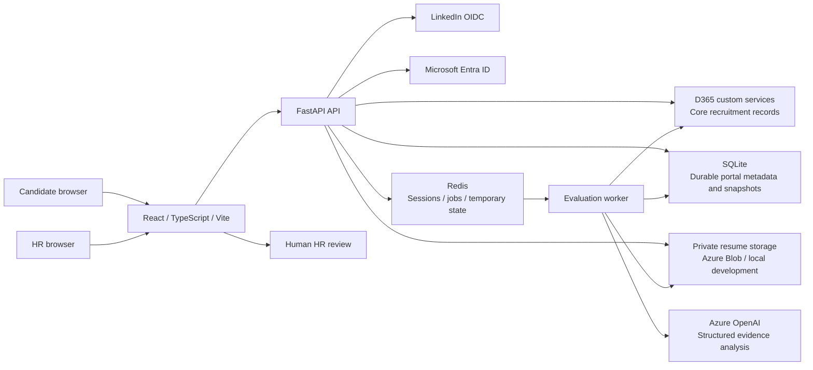

# Architecture and data ownership

TalentMatch AI provides a candidate recruitment portal and an authenticated HR evidence-review workspace. Its violet, rounded dashboard design follows the supplied reference theme. The frontend calls FastAPI; external credentials and integration requests stay on the backend.

## Submission and evaluation

The selected job stays attached to the OAuth authorization attempt. Sign-in returns the candidate to its application form with the permitted LinkedIn profile displayed and available contact fields prefilled. Missing or invalid provider contact details are completed by the candidate before submitting.

1. FastAPI validates the backend candidate session, CSRF token, confirmed contact details, explicit consent, open job, resume type/content, and upload size.
2. The storage adapter saves the real document privately and computes its SHA-256. SQLite freezes the confirmed contact/profile snapshot, consent, document reference, complete selected JD and one stable `ApplicationId` before calling D365.
3. The lean D365 adapter submits only the existing candidate/application business fields. Its X++ transaction upserts `UBCandidateTable` and saves the linked `UBJobApplicationTable`, preserving the supplied application ID. SQLite records the acknowledgement before the API queues evaluation and confirms submission without waiting for the model.
4. The worker extracts the complete readable PDF/DOCX text and supplies the complete job context to the Azure OpenAI adapter. The versioned system prompt treats document contents as untrusted data.
5. Pydantic validates structured model output and resume evidence excerpts. Python does not apply a scoring formula or replace the model score.
6. SQLite durably stores the full validated AI result before the D365 write. The evaluation adapter sends only selected score/evidence fields to `UBHRMatchEvaluationTable` using a stable `EvaluationId`; the same transaction updates the application's `OverallScore` and `AIStatus`. SQLite marks completion only after acknowledgement. A failed write can retry its cached result even after Redis loss.
7. Candidate history and HR ranking/detail read acknowledged SQLite snapshots through FastAPI. Scores organize the displayed results; a human reviews evidence and makes employment decisions. External F&O recruiter changes are not automatically synchronized by these three operations.

## Storage boundaries

| Component | Data responsibility |
| --- | --- |
| D365 F&O | Existing job requirements, core candidate/application records and selected evaluation score/evidence |
| SQLite | Immutable contact/identity/JD snapshots, private resume references and hashes, consent, timestamps, durable submission outbox, full evaluation/provenance and processing state |
| Azure Blob Storage | Private original PDF/DOCX documents |
| Redis | Protected sessions, queue transport, locks and temporary processing cache |
| Backend local storage | Development-only private document adapter |
| React | Presentation and transient form/query state; no integration secrets |

API and worker must use the same persistent SQLite file on one host; the Compose services share `/app/data/talentmatch.sqlite3`. SQLite and D365 do not share one distributed transaction: the durable outbox and stable identifiers coordinate retries across the two systems. Private documents remain in Blob Storage. Document, SQLite, D365, Redis and backup retention need explicit operational management.

## Demo boundary

`DEMO_MODE=true` selects separate fictional data and evaluation adapters. Demo authentication is allowed only in development. The application form still validates and stores a real uploaded document; its sample score is visibly a demo fixture. Connected mode returns integration errors when required configuration/services are absent and does not switch to fictional records.

## Contract boundaries

The default connected mode is `D365_CONTRACT_MODE=sqlite`: deploy the three-operation [source pack](../d365/README.md) against the exact screenshot tables. `getOpenRequirements`, `submitApplication` and `saveCandidateEvaluation` are the only D365 calls. Technical metadata is excluded from their write bodies. F&O compilation, actual EDT/index properties, security and live calls remain unverified.

`D365_CONTRACT_MODE=legacy` explicitly selects the earlier adapter for an already compatible service deployment; it does not use SQLite persistence. See [D365 endpoints](d365-endpoints.md) and [API contract](api-contract.md).
