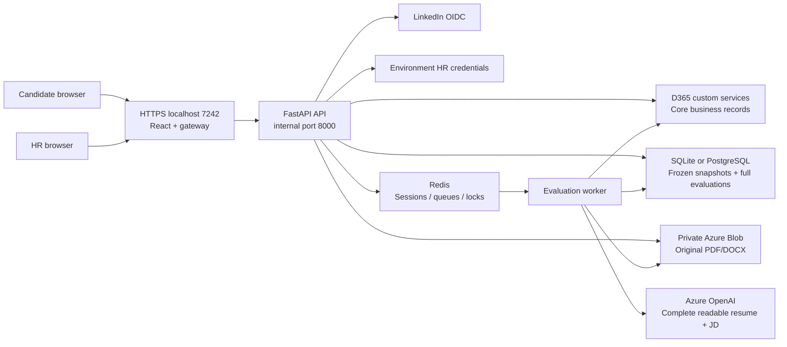

# Architecture and data ownership

TalentMatch AI Phase 1 connects candidate intake and HR evidence review to D365 F&O. The React frontend calls FastAPI; external service and database credentials stay server-side. The Docker gateway serves the portal and API at **https://localhost:7242**, preserving the exact LinkedIn callback `/auth/linkedin/callback`.

## Submission and evaluation

1. A selected job is bound to the LinkedIn OAuth authorization attempt. The validated callback returns the candidate to its application form, displays permitted profile information and prefills valid contacts. Missing contacts are confirmed by the candidate.
2. FastAPI checks session, ownership, CSRF, consent, job availability and PDF/DOCX contents/size. It stores the original document privately and calculates its SHA-256.
3. The metadata store durably freezes contact/identity, consent, private reference/checksum, complete selected JD, request fingerprint and stable `ApplicationId` before sending the business contract to F&O.
4. The F&O transaction upserts `UBCandidateTable` and creates/reuses the linked `UBJobApplicationTable`. The backend validates acknowledgement, records it durably, and queues evaluation without making the candidate wait for AI.
5. A separate worker reads the same private document, checks integrity and extracts complete readable text. Azure OpenAI receives the frozen full job context and best-effort identity-minimized resume.
6. Structured schema, source quotations, project titles and score/evidence consistency are validated. Whitespace-layout differences are allowed; unsupported quotes are rejected. Up to three bounded correction attempts can repair invalid output; no fallback score is invented.
7. The complete validated result is cached durably before the F&O save. `saveCandidateEvaluation` upserts a stable `EvaluationId` in `UBHRMatchEvaluationTable` and updates application `OverallScore`/`AIStatus` in its transaction. Completion requires matching acknowledgement.
8. HR lists/detail read acknowledged metadata snapshots, show evidence/internal state, and support failed-evaluation retry/refresh. Valid cached AI output is reused for save-only recovery. Candidate responses show business application status and omit internal AI status/evaluation.

Stable identifiers, outbox recovery and ERP uniqueness/upsert coordinate cross-system retries; they are not one distributed transaction. External ERP recruiter edits are not automatically synchronized.

## Storage boundaries

| Component | Responsibility |
| --- | --- |
| D365 F&O | Existing requirements, candidate/application rows and selected core evaluation fields |
| Metadata database | Immutable identity/contact/JD snapshots, consent, document references/hashes, timestamps, durable submission outbox, complete evaluation/provenance and processing state |
| Azure Blob | Private original resume bytes in connected mode |
| Redis | Server-side sessions, queue transport, locks and temporary coordination |
| Local document volume | Development/demo-only private storage adapter |
| React | Presentation and transient form/query state; no integration secrets |

`METADATA_BACKEND=sqlite` is default. API and worker must use the same absolute file on a shared **local** durable volume; the Docker image uses `/app/data/talentmatch.sqlite3`. SQLite WAL is not an independent multi-host database or an SMB/NFS-file deployment.

`METADATA_BACKEND=postgres` selects PostgreSQL/Supabase via server-only `DATABASE_URL` and verified TLS. The dedicated `talentmatch` schema stores the metadata tables with RLS and no public policies/grants. See [migration](supabase.md). The compatible ERP contract setting remains `D365_CONTRACT_MODE=sqlite` regardless of metadata engine.

Sharing PostgreSQL alone does not share sessions/queues/documents. Start with one active connected stack per metadata database. If multiple stacks are deliberately active, use the same private Redis endpoint/prefix, company and private Blob configuration. Database evaluation locks add duplicate-work protection; they do not turn independent Redis queues into a complete coordinated multi-host deployment.

Metadata and Blob are durable data, not expendable Redis cache. Backup/restore and retention must cover each store and ERP identifiers. An image export contains application software, not existing data or runtime secrets.

## Deployment and demonstration boundaries

The portable Compose group contains `web`, `api`, `worker`, `redis`; only `127.0.0.1:7242` is published. A unique per-machine localhost certificate must be trusted once before a recipient can use Docker Desktop group Play. External services still require network access. See [Docker handoff](docker-local.md).

`DEMO_MODE=true` is an explicit fictional adapter allowed only in development; demo uploads are real local files but scores are visibly labeled sample fixtures. Connected mode never silently substitutes fixtures. The default portable stack forces connected production mode; `compose.demo.yml` is an explicit development override.

The default three-operation contract calls only `getOpenRequirements`, `submitApplication`, and `saveCandidateEvaluation`. The optional `legacy` adapter targets an already compatible six-operation deployment and is not the current source-pack contract. Current scope and roadmap are detailed in the [technical](technical-reference.md) and [business](business-reference.md) references.
