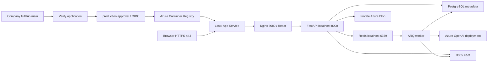

# Azure ACR and App Service: single-container deployment

This guide uses `Dockerfile.azure`, `deploy/azure/` and `.github/workflows/azure-app-service.yml`. The existing local Docker Compose package remains separate and continues using HTTPS localhost port 7242. No Azure resources are automatically created or company repository pushed by adding these files.

The Azure image contains Nginx/compiled React, FastAPI, **ARQ** and Redis under Supervisor. This project does not use Celery or SQL Server/ODBC, so those sample dependencies are not added. Browser requests use relative `/api/` and `/auth/` paths; no frontend API secret or build-time API hostname is needed.



## 1. Obtain the IT resources

Send [the IT request](azure-it-request.md). Obtain an approved single-instance Linux Web App for a classic custom container, ACR, OIDC identity, PostgreSQL, private Blob, Foundry/OpenAI deployment and Key Vault. Supabase is an option for PostgreSQL; Azure Database for PostgreSQL is also supported by the same connection setting.

The initial image embeds Redis in `/tmp/talentmatch`. API/worker/health bind only to container loopback; only Nginx port 8080 is exposed. Use **one App Service instance**. Do not enable autoscale or overlap independent production slots until a shared Redis deployment and rollout strategy are approved. Container replacement can clear sessions/queue transport; durable outbox snapshots recover work from PostgreSQL. Keep database and Blob backups separate.

## 2. Copy the code into the company repository yourself

Have the company create an **empty private repository** with no initial README/license commit. From your existing checkout:

```powershell
git pull --ff-only origin main
git status --short
git remote add company https://github.com/COMPANY/REPOSITORY.git
git push -u company main
```

Use your company's approved Git authentication. This preserves the existing personal `origin` and copies committed history to the new remote. `.env`, credentials, local certificates, image archives, resumes and databases must stay untracked. If the company requires a fresh history rather than the personal repository history, use a reviewed clean export/initial commit according to its policy. Do not use `--mirror` or force-push over an existing company repository. If the destination already has commits, clone it separately and import through a reviewed branch/PR.

For later changes, commit and push a feature branch to `company`, open a PR to company `main`, and merge after CI/review. `git push company main` explicitly selects the company remote; `git remote -v` lets you check names before pushing. No company push is performed by this implementation.

Markdown links follow the new repository automatically. The maintained Word documents contain your manual edits and are preserved. Update any personal GitHub hyperlinks in those documents using Word before a company handoff. If you want separate Markdown-derived drafts instead, this optional command sets their repository hyperlinks; it does not merge manual Word edits. Review the drafts before replacing a maintained document:

```powershell
$env:DOCUMENTATION_REPOSITORY_URL = 'https://github.com/COMPANY/REPOSITORY/blob/main/'
.\backend\.venv\Scripts\python.exe .\scripts\generate_reference_docs.py
```

## 3. Configure Azure container hosting and identities once

IT can use the Azure portal. Request **Linux / Container**, the company ACR image, an empty custom startup command (the image has its own entrypoint), Always On, HTTPS Only, minimum TLS 1.2, Health Check `/healthz`, and one instance.

This guide targets the classic custom-container mode, where `WEBSITES_PORT=8080` selects the target port. If IT creates a sidecar-enabled App Service instead, configure the main container's target port to **8080** in its container settings; do not assume `WEBSITES_PORT` configures that mode.

The following are **Azure Cloud Shell Bash** examples for an existing Web App and registry. Replace the non-secret names; IT needs role-assignment permission for the identity steps. These are not PowerShell commands.

```bash
RESOURCE_GROUP='your-resource-group'
WEBAPP_NAME='your-webapp-name'
ACR_NAME='yourregistryname'

app_id=$(az webapp show -g "$RESOURCE_GROUP" -n "$WEBAPP_NAME" --query id -o tsv)
acr_id=$(az acr show -n "$ACR_NAME" --query id -o tsv)
principal_id=$(az webapp identity assign -g "$RESOURCE_GROUP" -n "$WEBAPP_NAME" --query principalId -o tsv)
az role assignment create --assignee-object-id "$principal_id" --assignee-principal-type ServicePrincipal --scope "$acr_id" --role AcrPull
az webapp config set -g "$RESOURCE_GROUP" -n "$WEBAPP_NAME" --generic-configurations '{"acrUseManagedIdentityCreds":true,"alwaysOn":true,"healthCheckPath":"/healthz","minTlsVersion":"1.2"}' -o none
az webapp update -g "$RESOURCE_GROUP" -n "$WEBAPP_NAME" --https-only true -o none
az acr config authentication-as-arm show -r "$ACR_NAME"
# If company policy permits and it is disabled, IT enables ARM audience tokens:
# az acr config authentication-as-arm update -r "$ACR_NAME" --status enabled
az webapp log config -g "$RESOURCE_GROUP" -n "$WEBAPP_NAME" --docker-container-logging filesystem --web-server-logging off -o none
az webapp show -g "$RESOURCE_GROUP" -n "$WEBAPP_NAME" --query defaultHostName -o tsv
```

Use the actual returned hostname: newer App Service defaults can include a generated suffix/region. Do not construct the hostname from the app name. A custom domain must be bound and its certificate ready before using it in the application settings.

Assign App Service's identity `Key Vault Secrets User` on the approved vault. For ordinary RBAC ACR, it gets `AcrPull`; do not enable the ACR admin account for this pipeline. Network-protected ACR also needs approved VNet image-pull routing/DNS. Private resources require an appropriate company CI runner and reachable health endpoint.

## 4. Prepare the company GitHub OIDC deployment identity

IT creates a dedicated Entra app/service principal or user-assigned managed identity for CI. Add this federated credential:

```json
{
  "name": "talentmatch-github-production",
  "issuer": "https://token.actions.githubusercontent.com",
  "subject": "repo:COMPANY/REPOSITORY:environment:production",
  "audiences": ["api://AzureADTokenExchange"]
}
```

For an Entra application, IT can save the JSON as `credential.json` and use:

```bash
az ad app federated-credential create --id YOUR_ENTRA_APPLICATION_OBJECT_ID --parameters credential.json
```

The object ID in that command is not the client ID. GitHub's `AZURE_CLIENT_ID` is the application's client ID. A user-assigned managed identity uses its corresponding Azure identity federated-credential interface instead.

Grant this CI identity `AcrPush` on ACR and `Website Contributor` scoped to the Web App. The identity does not need subscription Owner, an ACR admin password or a stored Azure client secret. App Service's image-pull identity and GitHub's deployment identity are separate principals.

## 5. Configure application runtime settings

Copy `deploy/azure/appsettings.example.json` to a private file outside the checkout, replace every placeholder and check Key Vault references resolve. This is an Azure application-settings JSON object, **not a Docker `.env` file**. Set values in Azure Portal → Web App → Environment variables, or in Cloud Shell:

```bash
az webapp config appsettings set -g "$RESOURCE_GROUP" -n "$WEBAPP_NAME" --settings @/path/to/private-appsettings.json -o none
```

Using `-o none` avoids printing the resolved settings collection into terminal logs. The template itself contains no real secrets. Do not commit the completed private file. Key Vault references need the correct vault permissions/networking; unresolved references are not usable database URLs or API keys.

Core public settings:

```dotenv
APP_ENV=production
DEMO_MODE=false
FRONTEND_BASE_URL=https://ACTUAL_PUBLIC_HOST
BACKEND_BASE_URL=https://ACTUAL_PUBLIC_HOST
CORS_ALLOWED_ORIGINS=["https://ACTUAL_PUBLIC_HOST"]
LINKEDIN_REDIRECT_URI=https://ACTUAL_PUBLIC_HOST/auth/linkedin/callback
METADATA_BACKEND=postgres
DATABASE_SSLMODE=verify-full
D365_CONTRACT_MODE=sqlite
REDIS_URL=redis://127.0.0.1:6379/0
REDIS_PREFIX=talentmatch-production
WEBSITES_PORT=8080
WEBSITES_ENABLE_APP_SERVICE_STORAGE=false
WEBSITES_CONTAINER_START_TIME_LIMIT=600
WEBSITE_WARMUP_PATH=/healthz
WEBSITE_WARMUP_STATUSES=200
```

Set `DATABASE_URL` to the approved PostgreSQL URI, with a URL-encoded password and verified TLS. A blank `DATABASE_SSLROOTCERT` uses the runtime system trust. If the provider requires an additional CA, mount public trust material at a stable runtime path through the approved Azure storage/config mechanism and set the path; do not put a private CA key in the image or disable verification.

Keep the existing D365 three operation paths and actual company value. Configure `HR_USERNAME`/`HR_PASSWORD`, LinkedIn credentials, Azure OpenAI endpoint/key/deployment/API version and private Azure Blob settings. No `VITE_API_BASE_URL` is required: the built frontend calls the same host through Nginx.

In Azure, use the actual HTTPS origin with **no `:7242` suffix**. Azure terminates TLS on 443; Nginx inside the container accepts HTTP on 8080. Local certificates are not copied into this image. Do not disable HTTPS Only to work around cookie/OAuth failures.

The runtime preflight rejects localhost production URLs, origin/callback mismatches, blank HR credentials, SQLite production metadata or unverified database TLS. It does not prove external credentials or model capacity are valid; perform the acceptance checks below.

## 6. Migrate existing metadata before cutover

Use [the Supabase/PostgreSQL migration guide](supabase.md). Stop writers, make a consistent SQLite backup, dry-run the source, migrate and verify target counts/IDs. Keep the original private Blob account/container accessible; database migration does not copy resume bytes or ERP records. Do not run an old native worker against the same production dataset during cutover.

The image includes the migration CLI. An operator can run it as an explicit one-off container with approved private environment settings and a read-only source mount; the image entrypoint is overridden for this operation:

```powershell
docker run --rm --env-file C:\Private\migration.env --mount "type=bind,src=C:\Private\backup,dst=/backup,readonly" --entrypoint python talentmatch-azure:phase1 -m app.migrate_metadata --source /backup/talentmatch-backup.sqlite3 --dry-run
docker run --rm --env-file C:\Private\migration.env --mount "type=bind,src=C:\Private\backup,dst=/backup,readonly" --entrypoint python talentmatch-azure:phase1 -m app.migrate_metadata --source /backup/talentmatch-backup.sqlite3
```

Do not treat a successful migration as permission to drop the old source. Test restore and retain it according to policy. After Azure accepts new writes, rolling back the metadata engine to the old SQLite snapshot would lose those new portal views.

## 7. Configure GitHub variables and approval

In the **company repository**, Settings → Environments → create `production`; add required reviewers where supported. Configure main-branch protection/rulesets and limit who can change workflow files and environment settings.

Set these **repository-level Actions variables** (the workflow gate runs before environment approval):

| Variable | Value |
| --- | --- |
| `AZURE_DEPLOY_ENABLED` | `true`, only after IT has configured the runtime and access |
| `COMPANY_GITHUB_REPOSITORY` | Exact `COMPANY/REPOSITORY` owner/name |

Set these Actions variables at repository level or in environment `production`:

| Variable | Value |
| --- | --- |
| `AZURE_CLIENT_ID` | Federated deployment identity client ID |
| `AZURE_TENANT_ID` | Company Entra tenant ID |
| `AZURE_SUBSCRIPTION_ID` | Approved subscription ID |
| `AZURE_ACR_NAME` | Registry resource name, not its URL |
| `AZURE_RESOURCE_GROUP` | Resource group containing the Web App |
| `AZURE_WEBAPP_NAME` | Web App resource name |
| `AZURE_PUBLIC_APP_URL` | Actual public HTTPS origin, matching App Service settings |

The deploy workflow uses `ubuntu-latest`. For private Azure networking, change `runs-on` to the approved company runner label before enabling deployment; that runner needs Docker/buildx, Azure CLI and endpoint/network access. Do not expose private services merely to make a public runner reach them.

Runtime secrets live in App Service/Key Vault, not in GitHub build arguments. The identity values above are non-secret IDs. No publish profile or long-lived Azure password is required.

## 8. Run the pipeline

Push/merge to company `main`. **Verify application** runs the backend/frontend checks, real Redis/PostgreSQL tests and demo browser flow. Only its successful, same-repository `main` push/manual run triggers **Deploy Azure single container**. PR/fork runs and unsuccessful CI do not deploy. You may manually run **Verify application → Run workflow → main** to start an initial deployment after setting the variables.

After the `production` approval, deployment:

1. Checks out the exact commit that passed CI.
2. Authenticates to Azure with GitHub OIDC and signs into ACR.
3. Builds `Dockerfile.azure` for Linux/amd64, with only the commit SHA as a build argument.
4. Pushes `ACR_LOGIN_SERVER/talentmatch-portal:COMMIT_SHA` and deploys its immutable digest.
5. Polls HTTPS `/healthz` until **both** readiness and the exact deployed revision match. A still-running old revision is not counted as success.

On first deployment, App Service already needs managed-identity ACR pulls, runtime settings and port 8080 configured. Keep the Startup Command empty so the image entrypoint runs. ACR image publishing does not itself create the Web App or its runtime settings.

The workflow is disabled by default in repositories without the two explicit gate variables. Copying this code to a repository does not automatically spend Azure resources or publish it.

## 9. Manual build/push for diagnosis

From the source root in PowerShell with Docker Desktop running:

```powershell
docker build --platform linux/amd64 -f Dockerfile.azure --build-arg BUILD_REVISION=manual-review -t talentmatch-azure:phase1 .
az login
az account set --subscription YOUR_SUBSCRIPTION_ID
az acr login --name YOUR_ACR_NAME
$registry = az acr show --name YOUR_ACR_NAME --query loginServer -o tsv
docker tag talentmatch-azure:phase1 "${registry}/talentmatch-portal:manual-review"
docker push "${registry}/talentmatch-portal:manual-review"
```

Point the Web App's ACR image selection at the pushed tag, using its managed identity. This is an operator diagnostic path; the normal route is verified company-main CI/CD. Building an image never uploads `.env` or credentials, and the root `.dockerignore` excludes local data/certificates.

## 10. Register LinkedIn last, using the final hostname

Once IT confirms the real hostname and TLS are ready, register this exact Authorized Redirect URL in the company LinkedIn app:

```text
https://ACTUAL_PUBLIC_HOST/auth/linkedin/callback
```

Set the identical value in App Service `LINKEDIN_REDIRECT_URI`, along with matching LinkedIn client credentials. Confirm frontend/backend/CORS use the same origin. Restart the App Service after configuration changes. If a custom domain will be used, finish its DNS/TLS binding before registering/using it. Keep localhost callbacks only in the appropriate development LinkedIn app/configuration according to company policy; local Docker remains unchanged.

## 11. Acceptance, logs and rollback

Check `/healthz` returns `200` and the expected `revision`; it checks API, Redis and worker heartbeat. `/api/health` alone does not prove the worker is ready. It is not a live test of all external providers.

Use a permitted synthetic resume/JD to verify: selected-job LinkedIn return, profile/contact entry, application acknowledgement in F&O, Blob storage, AI structured evidence, `UBHRMatchEvaluationTable`, HR authorized resume access/retry, candidate privacy and logout. A score remains contextual evidence, not a hiring decision or an objectively correct measure.

Use App Service Log Stream/container logs for safe stage diagnostics. The image redacts OAuth access-log query strings, suppresses verbose auth upstream errors, logs processes to stdout/stderr and runs as UID 10001. Verify platform diagnostics do not reintroduce full OAuth URL/provider/resume payload capture.

For rollback, identify a previously verified image digest in ACR, select that exact digest in the Web App container configuration and restart. With Azure CLI in Bash:

```bash
az webapp config container set -g "$RESOURCE_GROUP" -n "$WEBAPP_NAME" --container-image-name 'YOUR_ACR_LOGIN_SERVER/talentmatch-portal@sha256:PREVIOUS_VERIFIED_DIGEST' --docker-registry-server-url 'https://YOUR_ACR_LOGIN_SERVER' -o none
az webapp restart -g "$RESOURCE_GROUP" -n "$WEBAPP_NAME"
```

Verify its `/healthz` revision and application flow. Code rollback does not revert PostgreSQL/ERP writes. Take backups before future schema changes and use a separately reviewed data rollback plan. No deployment slot swap or horizontal scaling is configured for embedded Redis.

## References

- [App Service custom-container configuration](https://learn.microsoft.com/azure/app-service/configure-custom-container): target ports, managed-identity ACR pulls and TLS termination.
- [GitHub Actions to App Service](https://learn.microsoft.com/azure/app-service/deploy-github-actions): identity federation and deployment actions.
- [Azure OpenAI structured outputs](https://learn.microsoft.com/azure/ai-foundry/openai/how-to/structured-outputs): verify model/API compatibility and region availability with IT.
- [Project IT request](azure-it-request.md), [local Docker](docker-local.md), [PostgreSQL migration](supabase.md), [validation record](validation.md).
