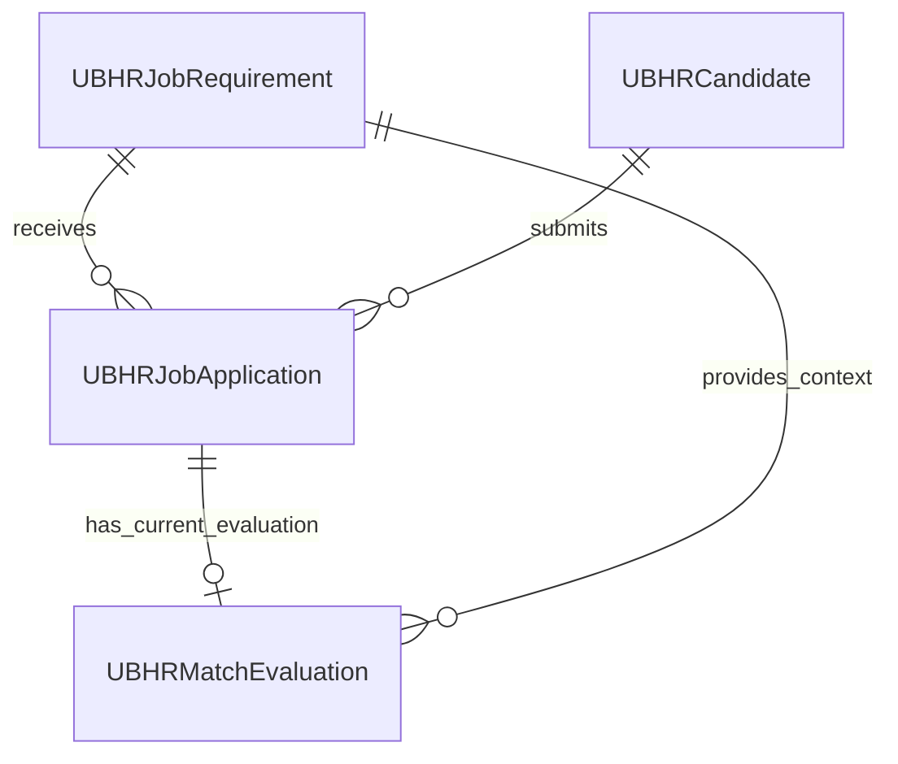

# D365 business schema

The implementation source pack is in [d365/](../d365/README.md). Its [TABLES.md](../d365/TABLES.md) specifies every field, EDT, enum, index, relation and designer property; [table-specification.json](../d365/table-specification.json) is the machine-readable checklist. Those files supersede the earlier logical proposal.

D365 Finance & Operations is the connected portal's business system of record. React calls FastAPI, which calls JSON custom services. Redis holds sessions, submission coordination, processing state and cached context; private Azure Blob Storage holds documents. The portal does not connect directly to F&O SQL or create a separate SQL business database.

The baseline implements these four tables. An existing authoritative requirement table must be mapped deliberately before rollout; creating `UBHRJobRequirement` does not migrate existing jobs. F&O build, synchronization and live acceptance are still required.

| Table | Stored information |
| --- | --- |
| `UBHRJobRequirement` | Full JD, responsibilities, skills, qualifications, certifications, advertised conditions, eligibility dates and criteria |
| `UBHRCandidate` | Current confirmed contacts, authenticated issuer/subject, identity digest, optional provider snapshot and consent |
| `UBHRJobApplication` | Candidate/job relations, immutable ownership and contact/profile snapshot, private document reference/checksums, consent, status and submission retry key |
| `UBHRMatchEvaluation` | One current application-linked assessment, model score, evidence/gaps JSON, explanation, provenance and completion time |

## Relationships and identity

`RecId` is the technical F&O identifier; all external requirement/candidate/application/evaluation IDs share the 40-character `UBHRExternalId` EDT. Candidate/application/evaluation IDs use a four-character prefix plus a 36-character GUID. Tables use `SaveDataPerCompany=Yes`; indexes receive company scope through F&O metadata conventions.

Candidate identity is the validated `(LinkedInIssuer, LinkedInSub)` pair, never name or email. A unique 64-character SHA-256 `IdentityKey` indexes its length-prefixed UTF-8 representation, avoiding a wide string composite index. The service compares the original issuer/subject with ordinal case sensitivity after lookup.

The mapped integration user's current/default company must match `D365_COMPANY`. Parameterless job reads use that company context; the five request-bearing operations require `Company` to match it. This implementation does not route arbitrary browser-selected legal entities.

## Persistence order

1. LinkedIn sign-in returns the candidate to the selected job/form and prefills only available public profile fields. It does not create an application or run AI comparison.
2. The candidate confirms their full name/contact email, optional phone/profile URL, resume and consent.
3. `submitApplication` validates the open job inside a transaction, upserts the candidate, then inserts the linked application snapshot. Both commit before a stable `ApplicationId` is acknowledged.
4. The backend queues the acknowledged application. The separate worker reads the actual uploaded document and complete selected JD, calls Azure OpenAI, and validates the structured result.
5. `saveCandidateEvaluation` saves the result separately and updates application `AIStatus=Completed` in the same transaction.

A subsequent application may update current candidate contacts while earlier application snapshots remain unchanged. A pending application's service response has `Evaluation=null`; it never invents a zero score or evidence. A real completed score of zero is preserved.

## Retry and evaluation rules

The unique application `IdempotencyKey` and its `PayloadHash` persist the original submission request. Identical retries return the same application, including after job closure; reuse with different contact/job/document data fails. Candidate identity and application-key races use bounded transactional retries and unique database indexes. A Redis lock alone is insufficient.

Evaluation `ApplicationRecId` is unique, providing one current evaluation per application. Its requirement is derived from the linked application; a conflicting request requirement fails. Identical evaluation content is a no-op. Changed validated content replaces the current assessment under the worker's fixed `evaluation:<ApplicationId>` key while retaining the evaluation ID. Historical versions would require a separate table and selection rule.

The service preserves the model's validated 0–100 score. Evidence labels and minimum-criteria assessments support human review; they do not change HR status or make a hiring decision.

## Profile, document and text fields

`LinkedInProfileJson` contains the validated issuer/subject and available allowlisted name, given/family name, valid email, email verification, HTTPS picture and locale. Nested keys retain standard OIDC spelling. OAuth tokens, raw token responses and session state are excluded. The provider's email-verification flag does not verify a different application contact email.

Missing provider contacts remain absent so the candidate can enter them. A subject/member URN is an identity, not an email or public profile URL. An absent profile snapshot is stored blank and serialized as `{}` by the DTO.

Long JD, explanation and JSON fields use String fields with the standard unbounded `Notes` EDT. Evidence arrays remain JSON text (`[]` for an empty array). No document Base64 is persisted. `ResumeBlobKey` preserves the backend-generated private reference unchanged, including its `azure:` prefix; the original resume lives in private Blob Storage.

In this baseline numeric advertised values are explicit: zero means zero, not unavailable. Populate accurate experience and opening values before publishing a requirement; adapting a legacy nullable schema requires an explicit contract mapping.

## Status and additional capabilities

`AIStatus` tracks processing and `HRStatus` tracks human review. The six implemented operations cover jobs, submissions, current evaluation persistence, ranking, owned history and detail. Separate Processing/Failed writes, HR status editing, job-maintenance UI, deletion/retention services, historical evaluations and server-side pagination are additional capabilities requiring their own reviewed contracts.

Demo mode keeps candidate masters and application snapshots in memory, resets on restart, and displays labeled fictional evaluation fixtures. It does not write these D365 tables. Source/contract checks are documented in [validation.md](validation.md); no live F&O deployment is claimed.
